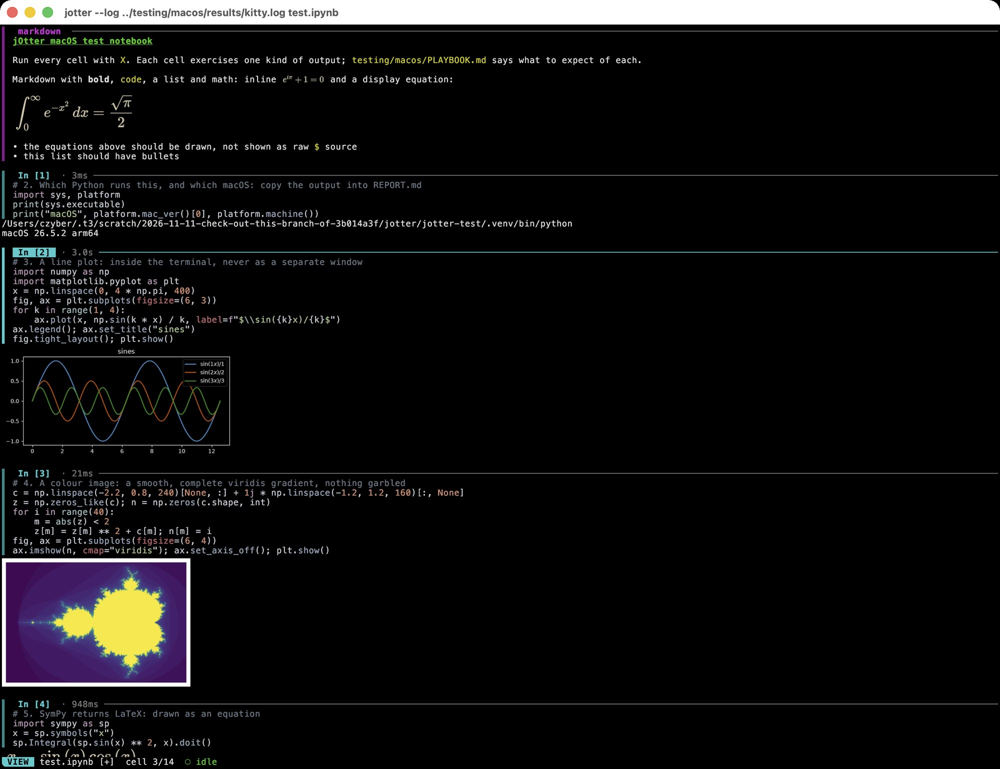
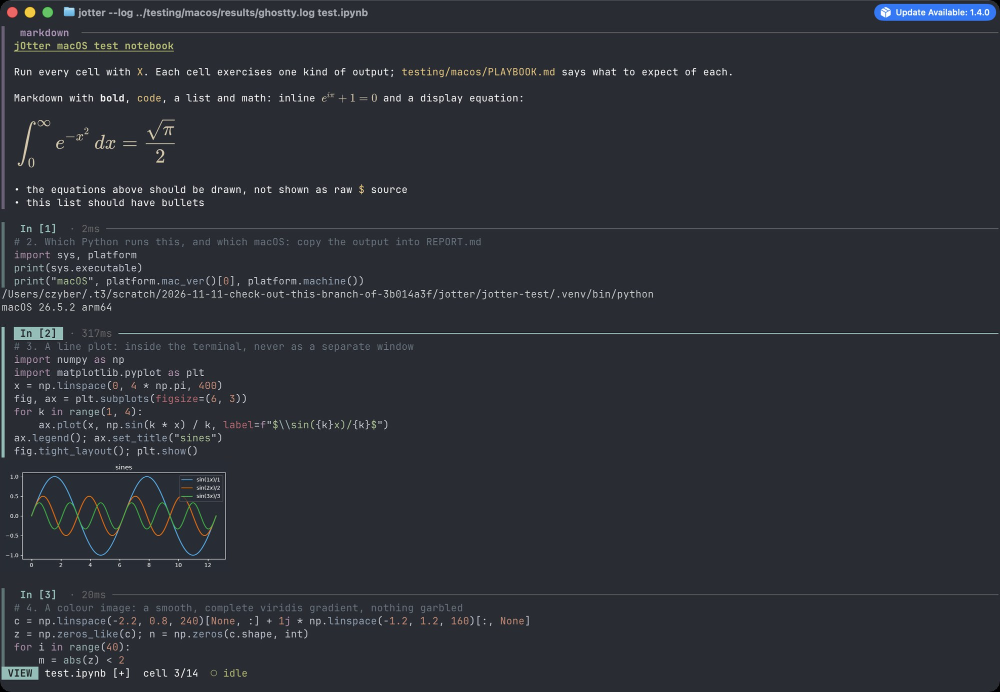
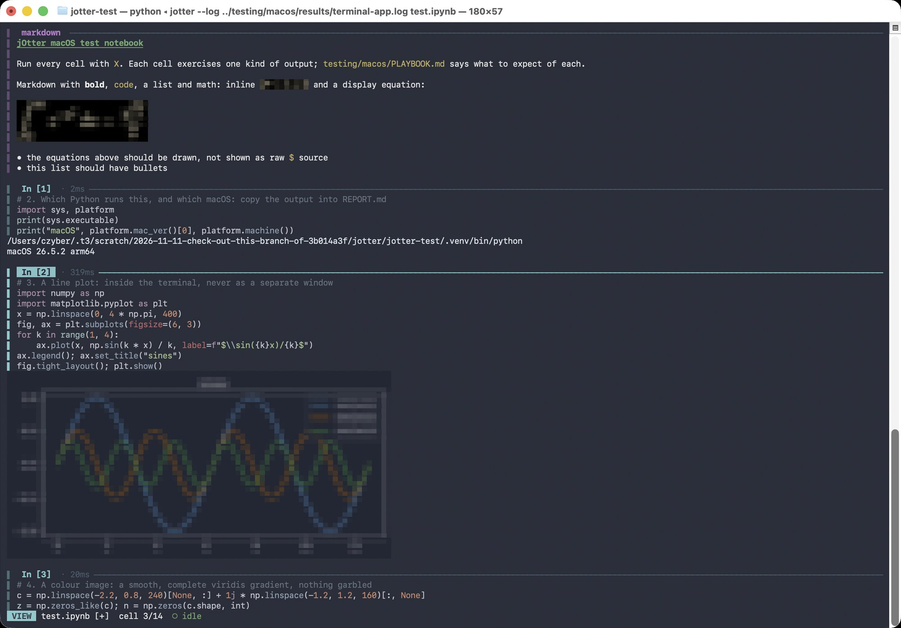
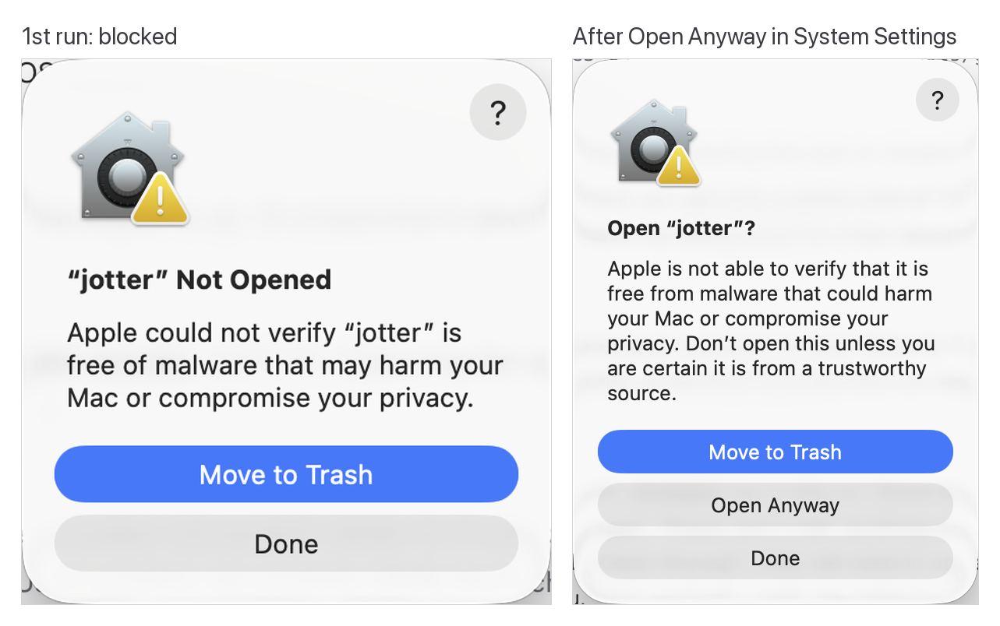
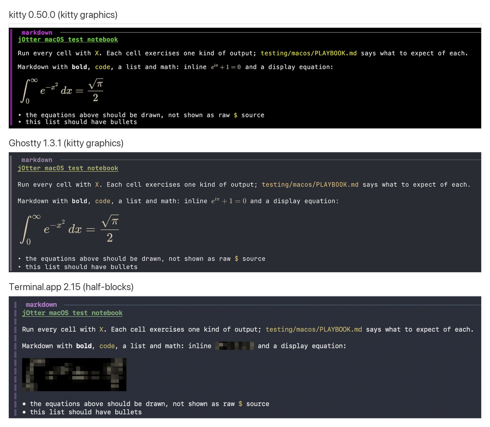
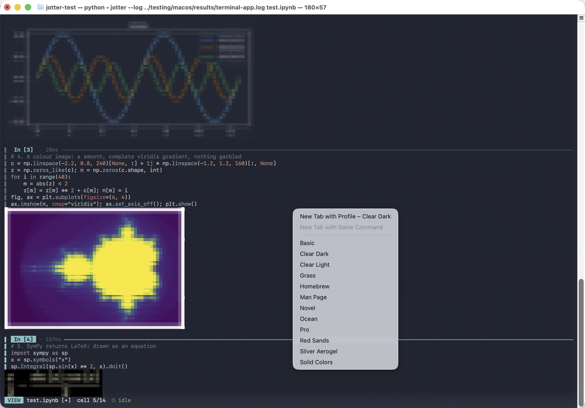
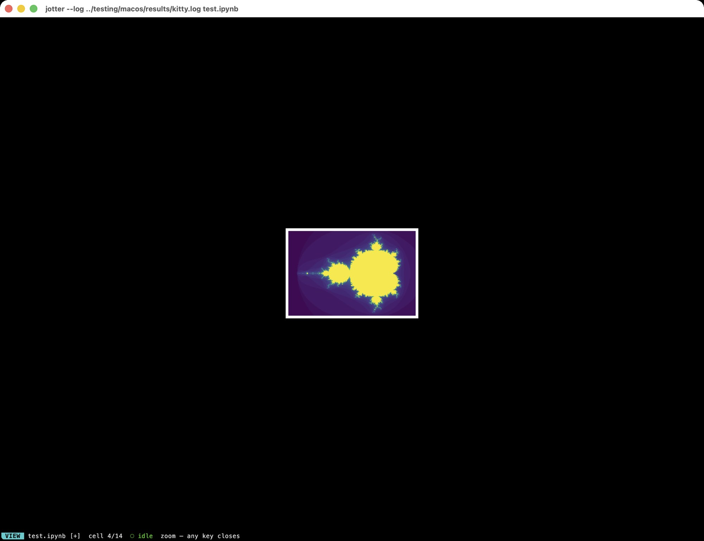
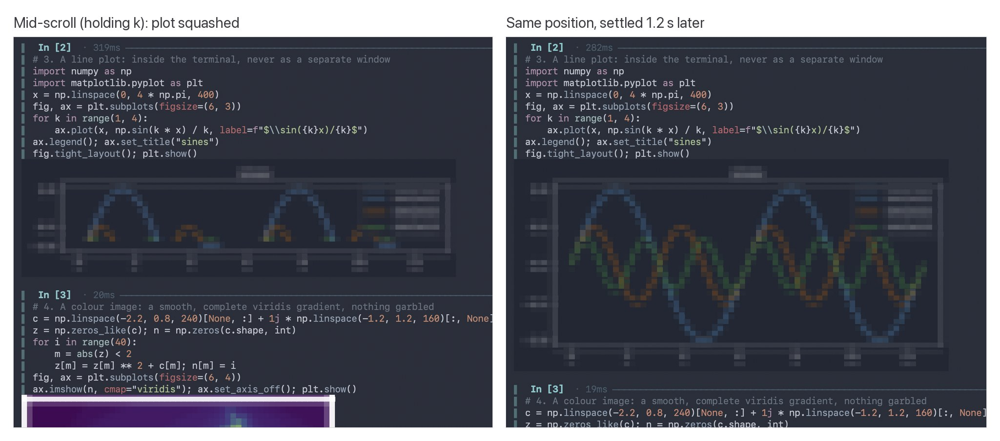
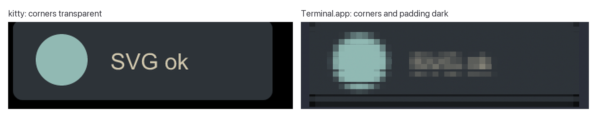

# jOtter 0.6.0 on macOS: Test Report

| | |
| --- | --- |
| **Product** | jOtter 0.6.0, release binary `jotter-aarch64-macos.tar.gz` and PyPI `jotter-tui` |
| **Branch tested** | `macos-test` at `8d6f612` (playbook in `testing/macos/PLAYBOOK.md`) |
| **Platform** | macOS 26.5.2 Tahoe (25F84), Apple M5, APFS case-insensitive, zsh |
| **Terminals** | kitty 0.50.0 · Terminal.app 2.15 (470.2) · Ghostty 1.3.1 |
| **Date** | 2026-11-11 |
| **Tester** | czyber, with Claude Code automation ([method](#4-method)) |
| **Playbook form** | [`REPORT.md`](REPORT.md) (filled in) · raw evidence in [`results/`](results/) |

---

## 1. Executive summary

**jOtter 0.6.0 works on Apple Silicon running macOS 26.** In kitty and Ghostty every playbook check passed: plots and math are sharp, Shift+Enter and Ctrl+Enter work, `yy` reaches the macOS clipboard, and resizing, fullscreen and fast scrolling are clean. Kernel discovery from a `.venv` next to the notebook worked without activating anything. Saving handles spaces, accented names (NFC and NFD) and case-folding correctly.

The issues are at the edges, where macOS behaves differently from Linux:

- **Installing from the tarball is fragile.** Gatekeeper's default button is **Move to Trash**, and it deleted the binary on the first attempt.
- **Notebooks in iCloud Drive** start a kernel that waits on a macOS privacy dialog. jOtter gives no hint, and the kernel times out after 30 s.
- **Terminal.app**, the terminal every Mac has, works with the expected fallbacks, but math is unreadable, Ctrl+Enter is taken by Terminal itself, and `yy` reports a copy that never happens.

| Severity | Count | Findings |
| --- | :---: | --- |
| High | 2 | [F-01](#f-01-gatekeepers-default-button-deletes-the-binary) Gatekeeper, [F-02](#f-02-kernel-hangs-on-a-privacy-dialog-for-notebooks-in-icloud-drive) iCloud kernel |
| Medium | 5 | [F-03](#f-03-math-is-unreadable-in-half-block-terminals) math in half-blocks, [F-04](#f-04-ctrlenter-never-reaches-jotter-in-terminalapp) Ctrl+Enter in Terminal.app, [F-05](#f-05-yy-reports-success-without-a-clipboard-in-terminalapp) `yy` in Terminal.app, [F-06](#f-06-zi-never-enlarges-plots-are-half-size-on-retina) `zi` and Retina, [F-07](#f-07-ctrl-on-germanaustrian-layouts-inserts-a-7) Ctrl+\ on German layouts |
| Low | 6 | [F-08](#f-08-torn-frames-while-scrolling-in-terminalapp) to [F-13](#f-13-test-notebook-is-not-in-canonical-nbformat) |
| Docs | 1 | [F-14](#f-14-playbook-statements-that-no-longer-match) playbook drift |

*Severity: **High**: a typical first-time Mac user is blocked or loses their setup. **Medium**: wrong or misleading behaviour with a workaround. **Low**: cosmetic or minor.*

---

## 2. Scope and environment

| Area | Detail |
| --- | --- |
| Hardware | Apple M5 (arm64) |
| OS | macOS 26.5.2 (25F84), Gatekeeper set to *App Store & Known Developers* |
| Python | uv 0.13.6; `setup.sh` created `.venv` with Python 3.14.10, ipykernel, numpy, matplotlib, sympy, pandas |
| Keyboard | ABC (US) layout; Austrian layout for the [F-07](#f-07-ctrl-on-germanaustrian-layouts-inserts-a-7) check |
| iCloud | iCloud Drive enabled, storage quota full (uploads fail, see step 5.3) |
| Tested terminals | kitty 0.50.0 (Homebrew cask, default config), Terminal.app 2.15 (profile "Clear Dark"), Ghostty 1.3.1 (default config) |
| Not tested | iTerm2, WezTerm, Alacritty, Warp, tmux |

---

## 3. Results at a glance

### 3.1 Playbook steps

| Step | Result | Summary |
| --- | :---: | --- |
| 1 Clone and set up | ✅ Pass | Chrome download (quarantined), SHA256 verified, `setup.sh` finished with `ready` in 2.5 s. macOS `tar` copied the quarantine flag to the extracted binary itself, so the script's fallback never ran. |
| 2 Gatekeeper and install | ✅ Pass | Blocked on the first run as intended; bypassed via Open Anyway. Completions, man page and `uvx` all work. See [F-01](#f-01-gatekeepers-default-button-deletes-the-binary), [F-11](#f-11-shell-completions-list-the-hidden---generate). |
| 3 Test notebook | ✅ Pass | All 14 cells behave as the playbook says, apart from cell 12 ([F-09](#f-09-stderr-looks-the-same-as-stdout)) and the cell 13 prompt location ([F-14](#f-14-playbook-statements-that-no-longer-match)). |
| 4 Terminals | ⚠️ Pass with findings | kitty and Ghostty: clean. Terminal.app: expected fallbacks plus [F-03](#f-03-math-is-unreadable-in-half-block-terminals), [F-04](#f-04-ctrlenter-never-reaches-jotter-in-terminalapp), [F-05](#f-05-yy-reports-success-without-a-clipboard-in-terminalapp), [F-08](#f-08-torn-frames-while-scrolling-in-terminalapp). |
| 5 Files on a Mac | ⚠️ Pass with findings | NFC/NFD paths and case-folding are correct; iCloud saves stick, but see [F-02](#f-02-kernel-hangs-on-a-privacy-dialog-for-notebooks-in-icloud-drive). |

### 3.2 Terminal matrix

| Check | kitty 0.50.0 | Ghostty 1.3.1 | Terminal.app 2.15 |
| --- | --- | --- | --- |
| Graphics detected | kitty, 14×25 px cells | kitty, 16×34 px cells | half-blocks, "7×15 px" (points) |
| Plots | ✅ sharp | ✅ sharp | ✅ blocky (expected) |
| Math | ✅ sharp | ✅ sharp | ❌ unreadable ([F-03](#f-03-math-is-unreadable-in-half-block-terminals)) |
| Shift+Enter | ✅ runs, moves down | ✅ runs, moves down | ⚪ opens the cell editor (expected) |
| Ctrl+Enter | ✅ runs in place | ✅ runs in place | ❌ opens Terminal's profile menu ([F-04](#f-04-ctrlenter-never-reaches-jotter-in-terminalapp)) |
| `r` / `Space` | ✅ | ✅ | ✅ |
| `yy` → clipboard | ✅ no prompt | ✅ no prompt | ⚪ nothing copied (expected), ❌ but reported as copied ([F-05](#f-05-yy-reports-success-without-a-clipboard-in-terminalapp)) |
| Ctrl+\ split (ABC layout) | ✅ | ✅ | ✅ (arrives as Ctrl+4) |
| `zi` zoom | ⚠️ not enlarged ([F-06](#f-06-zi-never-enlarges-plots-are-half-size-on-retina)) | ⚠️ not enlarged | ⚠️ slightly enlarged |
| Resize, fullscreen | ✅ | ✅ | ✅ |
| Holding j/k | ✅ clean | ✅ clean | ⚠️ transient torn frames ([F-08](#f-08-torn-frames-while-scrolling-in-terminalapp)) |
| After quit | ✅ prompt, no leftovers, selection works | ✅ | ✅ |

✅ as expected · ⚪ limitation the playbook expects · ⚠️ works with a caveat · ❌ wrong behaviour

### 3.3 Terminal capabilities (queried directly)

| Query | kitty 0.50.0 | Terminal.app 2.15 |
| --- | --- | --- |
| Synchronized output, `DECRQM ?2026` | `?2026;2$y` (supported) | no reply |
| Kitty keyboard protocol, `CSI ? u` | `?0u` | no reply |
| `XTVERSION` | `kitty(0.50.0)` | no reply |
| Window size, `CSI 14t` | 2590×1725 (pixels) | 1280×857 (**points**) |
| Cell size, `CSI 16t` | 14×25 | no reply |
| Background, `OSC 11` | `rgb:0000/0000/0000` | `rgb:213d/2743/33e7` |

### 3.4 Rendering in the three terminals

kitty and Ghostty draw the test notebook exactly as intended. In Terminal.app plots fall back to coarse but recognisable half-blocks.

| kitty 0.50.0 | Ghostty 1.3.1 | Terminal.app 2.15 |
| --- | --- | --- |
|  |  |  |

---

## 4. Method

- **Real input.** Keys were sent as macOS key events through System Events, so each terminal applied its own key encoding exactly as for typed keys. Mouse selection used real CGEvent drags.
- **Observation.** Each check was confirmed with a screenshot of that terminal's window. Screen text came from kitty's remote control for kitty and from Apple's Vision OCR for Terminal.app and Ghostty. Terminal capabilities were queried with escape sequences (§3.3).
- **Security prompts.** The tester answered the Gatekeeper and privacy dialogs by hand. Every prompt is recorded as it appeared.
- **Holding a key** was simulated as about 30 keystrokes per second, roughly macOS key-repeat speed, with screenshots during the scroll. Flicker a human would notice between captured frames can't be ruled out.
- **Logs** for each session: `results/{kitty,terminal-app,ghostty,files,icloud}.log`.

---

## 5. Findings

### F-01 Gatekeeper's default button deletes the binary

| Severity | Area | Affects |
| --- | --- | --- |
| **High** | Install | Everyone installing from the GitHub tarball |

**Observed.** The first run of the quarantined binary is killed (`zsh: killed ./release/jotter --version`, exit 137), and macOS shows *"jotter" Not Opened*. Its highlighted default button is **Move to Trash**. On the first attempt a click on it deleted the binary. After Open Anyway in System Settings › Privacy & Security, which needs Touch ID or a password, the next run shows a second dialog, *Open "jotter"?*. **Move to Trash** is again the default there; **Open Anyway** is the middle button. After Open Anyway the waiting process continued and printed `jotter 0.6.0`, and the quarantine flag changed from `0281` to `02c1`.



*Figure 1. The two Gatekeeper dialogs. In both, the destructive action is the default.*

**Recommendation.**
1. *Docs, now:* spell out the path on the install page: **Done** (not Move to Trash) → System Settings › Privacy & Security › **Open Anyway** → run again → **Open Anyway**.
2. *Docs, now:* point Mac users at `uv tool install jotter-tui`. Installs through uv aren't quarantined; `uvx` showed no Gatekeeper prompt in this test.
3. *Later:* a Homebrew tap (formula installs aren't quarantined) or Developer ID signing plus notarization removes the problem entirely. The binary is currently ad-hoc linker-signed; `spctl` rejects it and `syspolicy_check` reports *Notary Ticket Missing*.

---

### F-02 Kernel hangs on a privacy dialog for notebooks in iCloud Drive

| Severity | Area | Affects |
| --- | --- | --- |
| **High** | Kernel start | Notebooks in iCloud Drive; likely also Desktop/Documents when synced with iCloud (not tested) |

**Observed.** Opening `~/Library/Mobile Documents/com~apple~CloudDocs/jotter-icloud.ipynb` (venv activated) started the kernel, and macOS asked *"kitty" wants to access files managed by "iCloud Drive"*. jOtter's own read and save worked while the dialog was open; the kernel's start, with its working directory in iCloud Drive, is what triggered it. jOtter showed only:

```text
status: kernel starting — 1 cell(s) queued
status: kernel 'python3' failed: iopub connect: Connect timed out after 30s — 1 queued run(s) dropped
```

Nothing points to the dialog. After **Allow**, `R` started a kernel immediately. Both saves (about 75 s apart) then stuck without a "changed on disk" warning. iCloud itself never rewrote the file, because its upload failed on the full quota (`brctl`: *Error uploading asset: Quota exceeded*).


*Figure 2. The dialog that blocks the kernel. jOtter's status line doesn't mention it.*

**Recommendation.** When a kernel has been "starting" for about 5 s on macOS, add a hint to the status line, e.g. *"still starting — is macOS asking for permission in a dialog?"*, and repeat it in the timeout message. The 30 s limit comes from the zeromq connect at `src/kernel.rs:258`.

---

### F-03 Math is unreadable in half-block terminals

| Severity | Area | Affects |
| --- | --- | --- |
| **Medium** | Rendering | Terminal.app (and any terminal without kitty/sixel/iTerm2 graphics) |

**Observed.** Inline math, display math and SymPy's LaTeX output (cells 1, 5, 10) are rasterised at 1×2 pixels per cell. The result can't be read, which is worse than showing the LaTeX source. The images also sit on black boxes that clash with non-black themes; the plots are recoloured to the theme correctly.



*Figure 3. The same Markdown cell in three terminals.*

**Recommendation.** In half-block mode, render math as text: the LaTeX source, or a Unicode approximation such as `∫₀^∞ e^{−x²} dx = √π / 2`. At the least, fill the background with the queried terminal colour (OSC 11).

---

### F-04 Ctrl+Enter never reaches jOtter in Terminal.app

| Severity | Area | Affects |
| --- | --- | --- |
| **Medium** | Input | Terminal.app |

**Observed.** Ctrl+Enter opens Terminal.app's own **New Tab with Profile** menu. The key never reaches jOtter, the menu swallows the next keystrokes, and an Enter afterwards opens a new tab. Shift+Enter arrives as plain Enter and opens the cell editor, as the playbook expects. `r` and `Space` work.



*Figure 4. Terminal.app intercepts Ctrl+Enter.*

**Recommendation.** jOtter can't intercept it, so document it: *"Terminal.app: run cells with `r` / `Space`; Ctrl+Enter opens Terminal's tab menu."* A one-time status hint in legacy keyboard mode the first time Enter is pressed (*"Shift+Enter isn't distinguishable here: `r` runs the cell"*) would catch Jupyter muscle memory.

---

### F-05 `yy` reports success without a clipboard in Terminal.app

| Severity | Area | Affects |
| --- | --- | --- |
| **Medium** | Clipboard | Terminal.app (no OSC 52) |

**Observed.** `yy` shows *"cell yanked (p pastes) · source on the clipboard"*, but the macOS clipboard is unchanged (checked with a sentinel value and `pbpaste`). In kitty and Ghostty the same action copies the cell source with no prompt.


*Figure 5. The status line claims a copy that didn't happen.*

**Recommendation.** On macOS, when `TERM_PROGRAM=Apple_Terminal` and the session is local (no `SSH_TTY`), copy with `pbcopy` in addition to OSC 52 (`src/app.rs:245`). That makes `yy` work in the default Mac terminal. Otherwise, word the message so it doesn't promise a copy.

---

### F-06 `zi` never enlarges; plots are half-size on Retina

| Severity | Area | Affects |
| --- | --- | --- |
| **Medium** | Images | All terminals; most visible on Retina displays |

**Observed.** `zoom_image` (`src/ui.rs:885`) only shrinks images that are larger than the screen. A default matplotlib figure (100 dpi, 600×400 px) is smaller, so `zi` shows it at its inline size in the middle of an empty screen. On Retina, kitty reports cells in device pixels (14×25), so a 600 px figure covers 300 points: about a quarter of the area the same figure gets in browser Jupyter.



*Figure 6. `zi` on the Mandelbrot in a 1300×1000-point kitty window.*

**Recommendation.** Let `zi` scale up to fit the screen. On HiDPI terminals, render figures at 2× (`InlineBackend.figure_format = 'retina'` or a higher `figure.dpi` when the reported cell size is large). In half-block mode, scaling up also adds real detail.

---

### F-07 Ctrl+\ on German/Austrian layouts inserts a `7`

| Severity | Area | Affects |
| --- | --- | --- |
| **Medium** | Input | Mac German/Austrian layouts in terminals with the kitty keyboard protocol (tested: kitty) |

**Observed.** On these layouts `\` is Shift+Option+7, so "Ctrl+\" is Ctrl+Shift+Option+7. In kitty this didn't split the cell and **inserted a literal `7`** at the cursor:

```text
before:  print(sys.executable)          cursor after "print("
after:   print(7sys.executable)         no split
```

The event evidently arrives as Ctrl+Alt+Shift+`7`. The split binding (`src/app.rs:1215`) matches only `\` and `4`, and the editor then inserts the bare character with its modifiers dropped. **Ctrl+4 splits correctly** in kitty, and in Terminal.app Ctrl+Shift+Option+7 splits correctly.

**Recommendation.** Document Ctrl+4 as the split key that works on every layout; today it's mentioned only for tmux. Don't insert a character for key events that carry Ctrl or Alt.

---

### F-08 Torn frames while scrolling in Terminal.app

| Severity | Area | Affects |
| --- | --- | --- |
| **Low** | Rendering | Terminal.app |

**Observed.** Terminal.app doesn't support synchronized output (no reply to `DECRQM ?2026`), and half-block frames are large, so half-painted frames stay visible while j/k is held. 4 of 14 mid-scroll screenshots caught one: stale lines below new ones, a plot squashed to half height, a Mandelbrot stitched from two frames. It's transient: stepping one cell at a time with 1.2 s settle time gave **26 of 26 correct frames**, including images clipped at the screen edges. kitty and Ghostty showed nothing similar.



*Figure 7. Left: captured while holding `k`. Right: the same position after settling.*

**Recommendation.** On terminals without mode 2026, coalesce redraws while a key repeats, or draw images as placeholders during fast scrolling.

---

### F-09 stderr looks the same as stdout

**Low · Rendering · all terminals.** In cell 12 both lines are drawn with the same style (`ESC[37m`, read back from kitty). `src/ui.rs:1494` renders every `stream` output with `OUTPUT_STYLE` and ignores `name`. The playbook expects stderr to be marked differently. *Recommendation:* a dim red or a gutter mark for `name == "stderr"`.

### F-10 Transparent image areas render dark in half-blocks

**Low · Rendering · Terminal.app.** The SVG in cell 9 has rounded, transparent corners. kitty shows them transparent; in half-block mode the corners and the padding row below the image come out dark. *Recommendation:* composite transparency onto the queried background colour before converting to half-blocks.



*Figure 8. Cell 9's SVG: transparency is kept in kitty and lost in half-block mode.*

### F-11 Shell completions list the hidden `--generate`

**Low · Packaging.** `--generate` is declared `hide = true` and is correctly missing from the man page, but all four shipped completion scripts (`_jotter`, `jotter.bash`, `jotter.fish`, `jotter.nu`, generated in `src/gendocs.rs:22`) offer it. *Recommendation:* filter hidden arguments before generating completions.

### F-12 Recovery prompt overstates changed cells

**Low · Autosave.** `:q!` keeps the autosave on purpose (`src/app.rs:1085`). Reopening then offered *"autosave from 3s ago, 14 cell(s) differ"* after one cell had been edited and split. `differing_cells` (`src/app.rs:297`) compares cells by index, so one inserted cell marks every later cell as different. Recovery itself works well on macOS: a sidecar written under `Test.ipynb` was found when `test.ipynb` was opened. *Recommendation:* count changes with a diff alignment, or word it as "differs from cell N on".

### F-13 Test notebook is not in canonical nbformat

**Low · Test assets.** `testing/macos/test.ipynb` stores each `source` as a single string. The first save rewrites every cell into Jupyter's list-of-lines form, the same as Jupyter would, so every tester who saves it gets a large diff. *Recommendation:* commit the notebook as jOtter saves it.

### F-14 Playbook statements that no longer match

**Docs.** Behaviour is fine in each case; the playbook text is outdated:

| Playbook says | Actual 0.6.0 behaviour |
| --- | --- |
| Cell 13: prompt "appears in the status line" | A centred popup: `your name:` · *Enter sends · Esc sends empty* |
| 5.2: `:w Test.ipynb` "asks for a second Enter" | Refuses with `Test.ipynb exists — :w! Test.ipynb overwrites`; Enter opens the cell editor instead |
| 5.2: then `:q` | With the cell editor open, `:q` only closes the editor (vim-style), so jOtter keeps running |
| Ghostty `yy`: "asks the first time" | Ghostty 1.3.1 with default config copies without asking |
| Terminal.app: Shift/Ctrl+Enter "no: use r and Space" | True; add that Ctrl+Enter opens Terminal's tab menu ([F-04](#f-04-ctrlenter-never-reaches-jotter-in-terminalapp)) |

---

## 6. What worked well

- **Kernel discovery:** the `.venv` next to the notebook was found with nothing activated; the kernel was ready about 1.5 s after launch.
- **Unicode paths:** `my notes/ünïcode/tést.ipynb` opened, ran and saved, both typed (NFC) and in the NFD form Finder drag-and-drop produces. The atomic save keeps the existing name on APFS, so no duplicate files.
- **Case-folding:** `:w! Test.ipynb` over `test.ipynb` left one file with its original spelling.
- **Input robustness:** no keystrokes lost during startup (tested from 0.2 s after launch).
- **Clean exit** in every terminal: prompt restored, no leftover images, mouse selection works.
- **Smaller observations:** the run-all stop at the error, `clear_output` spinner, streaming with wide characters, and the long-output viewport all behaved as specified.

---

## 7. Recommendations

| Priority | Action | Findings | Effort |
| --- | --- | --- | --- |
| 1 | Install docs: Gatekeeper walkthrough; recommend `uv tool install jotter-tui` on macOS | F-01 | Docs |
| 2 | Kernel-start hint about macOS permission dialogs | F-02 | Small |
| 3 | `pbcopy` fallback for `yy` in local Terminal.app sessions | F-05 | Small |
| 4 | Document Terminal.app keys and Ctrl+4; don't insert characters for Ctrl/Alt events | F-04, F-07 | Docs + small |
| 5 | Math as text in half-block mode; background colour for math images | F-03 | Medium |
| 6 | `zi` upscaling; Retina-aware figure DPI | F-06 | Medium |
| 7 | stderr style, half-block transparency, hidden completions, recovery count | F-09 – F-12 | Small each |
| 8 | Update playbook text; commit `test.ipynb` in saved form | F-13, F-14 | Docs |
| 9 | Frame coalescing on terminals without mode 2026 | F-08 | Medium |
| 10 | Homebrew tap or notarized releases | F-01 | Project decision |

A Nix flake isn't needed for Mac testers: Homebrew plus uv was enough, and `setup.sh` ran in 2.5 s.

---

## Appendix A. Evidence index

| File | Shows |
| --- | --- |
| `results/01-gatekeeper-not-opened.png`, `02-gatekeeper-open-anyway.png`, `fig-01-gatekeeper-flow.png` | F-01 dialogs |
| `results/03-kitty-cells-1-5.jpg`, `12-ghostty-cells-1-3.jpg` | Reference rendering in kitty and Ghostty |
| `results/04-kitty-zi-does-not-enlarge.jpg`, `10-terminal-app-zi.jpg` | F-06 |
| `results/05-terminal-app-math-unreadable-plot-halfblocks.jpg`, `fig-02-math-rendering.jpg` | F-03 |
| `results/06-terminal-app-svg-and-input-popup.jpg`, `fig-03-svg-transparency.png` | F-10, cell 13 popup |
| `results/07-terminal-app-ctrl-enter-opens-menu.jpg` | F-04 |
| `results/08-…`, `09-terminal-app-torn-frame-…jpg`, `fig-04-torn-vs-settled.jpg` | F-08 |
| `results/11-icloud-permission-dialog-blocks-kernel.png` | F-02 |
| `results/fig-05-yy-status-terminal-app.png` | F-05 |
| `results/kitty.log`, `terminal-app.log`, `ghostty.log` | Detected graphics and keyboard protocol per terminal |
| `results/files.log`, `icloud.log` | Step 5 sessions, including the kernel timeout |

## Appendix B. Gatekeeper details

| Item | Value |
| --- | --- |
| Download quarantine | `0281;…;Chrome;AD30C75E-…` on the tarball; same UUID on the extracted binary |
| Signature | `adhoc,linker-signed`, no Team ID; `spctl --assess`: rejected |
| First run | process killed (exit 137), dialog *"jotter" Not Opened* |
| Approval | System Settings › Privacy & Security › Open Anyway (Touch ID/password), then *Open "jotter"?* › Open Anyway |
| After approval | quarantine flag `02c1`; the waiting process continued, no rerun needed |
| PyPI route | `uvx --from jotter-tui jotter --version` → `jotter 0.6.0`, no prompt |
